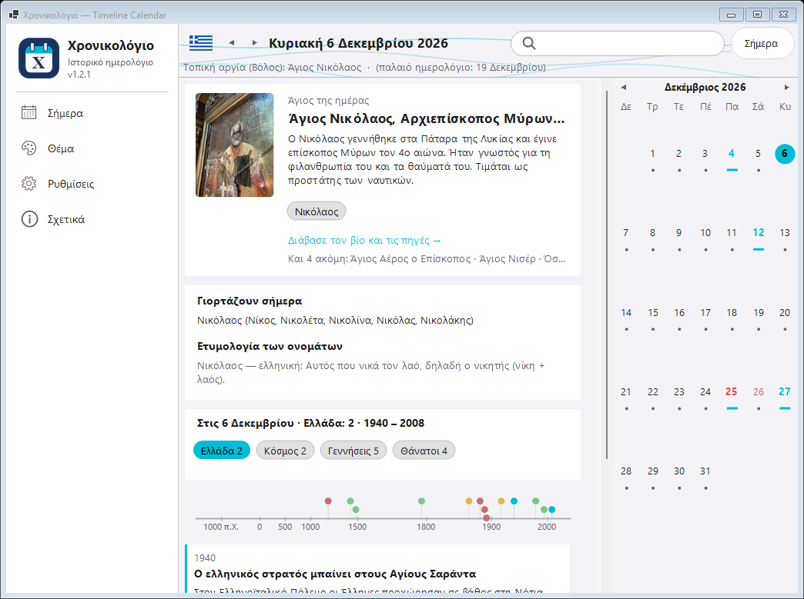

<p align="center"></p>

<p align="center"><a href="https://github.com/gs-applabs/san-shmera/releases/latest"></a> <a href="https://github.com/gs-applabs/san-shmera/releases"></a> <a href="https://github.com/gs-applabs/san-shmera/actions/workflows/windows-tests.yml"></a> <a href="https://github.com/gs-applabs/san-shmera/actions/workflows/product-snapshots.yml"></a></p>

<p align="center"><a href="docs/GS-APP-LABS-FAQ.md">FAQ / Συχνές ερωτήσεις</a> · <a href="https://github.com/gs-applabs/san-shmera/issues/new/choose">Feedback / Προτάσεις</a></p>

<p align="center"><strong>Discover today's name days, holidays and historical events for Greece and Cyprus.</strong><br/>Η ιστορία και το εορτολόγιο κάθε ημέρας.</p>

<p align="center"><a href="https://github.com/gs-applabs/san-shmera/releases/latest"></a> <a href="docs/SHOWCASE.md"></a></p>

<p align="center"><a href="#at-a-glance--με-μια-ματιά">Overview / Επισκόπηση</a> · <a href="#full-documentation--αναλυτική-τεκμηρίωση">Full documentation / Τεκμηρίωση</a> · <a href="https://github.com/gs-applabs/san-shmera/issues">Support / Υποστήριξη</a> · <a href="https://github.com/gs-applabs">GS App Labs</a></p>

## Visual showcase / Οπτική παρουσίαση

<table>
<tr>
<td width="50%" valign="top"><a href="docs/SHOWCASE.md"></a><br/><sub>window day light</sub></td>
<td width="50%" valign="top"><a href="docs/SHOWCASE.md"></a><br/><sub>window day dark</sub></td>
</tr>
</table>

**[Explore 14 screenshots / Εξερεύνηση στιγμιοτύπων](docs/SHOWCASE.md)** · [Original capture index](docs/product-snapshots/README.md) · [Media kit](https://github.com/gs-applabs/gs-applabs/tree/main/assets/showcase)

<sub>Actual UI previews from development commit `a4d12577d593`; may differ from the latest published installer. / Πραγματικές εικόνες συγκεκριμένου build ανάπτυξης, ενδέχεται να διαφέρουν από τη δημοσιευμένη έκδοση.</sub>

## At a glance / Με μια ματιά

| | What you can do / Τι μπορείς να κάνεις |
|---|---|
| **Today / Σήμερα** | Name days, saints and historical events / Εορτές, άγιοι και γεγονότα |
| **Explore / Εξερεύνηση** | Search and timeline browsing / Αναζήτηση και ιστορικό χρονολόγιο |
| **Connect / Διασύνδεση** | OPSIS plugin and News Crawler feed / Πρόσθετο και ροή ειδήσεων |

### Get started / Ξεκίνημα

For the newest installer always use [latest published release](https://github.com/gs-applabs/san-shmera/releases/latest). Version-specific links below are retained as reference. / Για τη νεότερη έκδοση χρησιμοποίησε τον σύνδεσμο τελευταίας δημοσιευμένης έκδοσης.

- **Installer:** [ChronikologioSetup.exe](https://github.com/gs-applabs/san-shmera/releases/download/v1.2.1/ChronikologioSetup.exe) · [SHA-256](https://github.com/gs-applabs/san-shmera/releases/download/v1.2.1/ChronikologioSetup.exe.sha256)
- **Requirements / Απαιτήσεις:** Windows 11 · .NET 11 Desktop Runtime.
- **What's new / Νέα έκδοση:** Update verification fixed; upgrade manually from 1.2.0 or earlier. / Διορθώθηκε ο έλεγχος ενημερώσεων· μία χειροκίνητη εγκατάσταση από 1.2.0 ή παλαιότερη.
- **Known limits / Όρια:** Historical and religious data have documented review states; the app is not an official authority. Installer unsigned. / Δεν αποτελεί επίσημη ιστορική ή εκκλησιαστική πηγή.

See the [published release](https://github.com/gs-applabs/san-shmera/releases/tag/v1.2.1) for verification details. Review installation prompts and compare the checksum before running the installer. / Δείτε τις σημειώσεις έκδοσης και επαληθεύστε το SHA-256 πριν από την εγκατάσταση.

---

## Full documentation / Αναλυτική τεκμηρίωση

# Χρονικολόγιο — Timeline Calendar

<p align="center">
  <strong>Ποιος γιορτάζει σήμερα και τι έγινε «σαν σήμερα» — για την Ελλάδα και την Κύπρο.</strong><br/>
  <strong>Who has a name day today and what happened «on this day» — for Greece and Cyprus.</strong>
</p>

<p align="center">
  
  
  
  
</p>

*English below / Αγγλικά παρακάτω.*

## Ελληνικά

Το **Χρονικολόγιο** είναι ημερολόγιο εορτών και ιστορίας για Windows: δείχνει τον άγιο της ημέρας, ποιοι γιορτάζουν, αργίες και νηστείες, και ιστορικά γεγονότα, γεννήσεις και θανάτους «σαν σήμερα». Λειτουργεί ως **αυτόνομη εφαρμογή** και ως **plugin του Opsis** (ροή «Σαν σήμερα» στο Opsis News Crawler).

| Λειτουργία | Τι κάνει |
|---|---|
| 📅 Ημέρα | Ο άγιος της ημέρας με εικόνα, σύντομο βίο και τα ονόματα που γιορτάζουν· κάρτες γεγονότων, γεννήσεων και θανάτων, με λωρίδα χρόνου από την αρχαιότητα ως σήμερα |
| 🇬🇷 🇨🇾 Χώρες | Ελλάδα και Κύπρος με δικό τους εορτολόγιο και γεγονότα· δεύτερη ημερομηνία του παλαιού ημερολογίου |
| 🖼 Φωτογραφίες | Πορτρέτα και φωτογραφίες γεγονότων μόνο από το Wikimedia Commons με ελεύθερη άδεια, με δημιουργό, άδεια και σύνδεσμο |
| 🔎 Αναζήτηση | Ctrl+K: όνομα, άγιος ή γεγονός |
| 🎨 Εμφάνιση | Θέματα φωτεινό/σκούρο, ελληνικό και αγγλικό περιβάλλον |
| 🧩 Opsis | Το plugin δίνει στον Opsis News Crawler τη ροή «Σαν σήμερα»· χωρίς Opsis, η ροή φτάνει στον News Crawler (0.30.0+) μέσω μικρού αρχείου στον φάκελο του χρήστη |

### Νέες ενότητες (κλάδος ανάπτυξης)

- **Εργαλεία ημερολογίου (Ctrl+1):** Γρηγοριανό, Ιουλιανό, Εβραϊκό, αριθμητικό ισλαμικό και Περσικό, μετατροπή και αντίστροφη μετατροπή, διαφορά ημερών, έτη/μήνες/ημέρες, εβδομάδα ISO, Δευτέρα–Παρασκευή (όχι επίσημες αργίες), επόμενη επέτειος. Τα ημερολόγια εφαρμόζονται αναδρομικά, όχι ως ιστορικές ημερομηνίες υιοθέτησης. Το αριθμητικό ισλαμικό δεν ισοδυναμεί με παρατήρηση νέας σελήνης.
- **Αστρονομία (Ctrl+2):** τοπική ανατολή/δύση Ήλιου και Σελήνης, διάρκεια ημέρας, φάση και φωτισμός Σελήνης, ετήσιες ισημερίες/ηλιοστάσια, παγκόσμιες εκλείψεις, σύνοδοι με Ήλιο και αντιθέσεις πλανητών. Εύρος 1800–2100. Έξι ενδεικτικές θέσεις Ελλάδας/Κύπρου, ρυθμιζόμενη προεπιλογή. Τα ετήσια φαινόμενα εμφανίζονται σε UTC. Οι εκλείψεις δεν δηλώνουν τοπική ορατότητα. Η διάρκεια ημέρας αφορά ιδανικό ορίζοντα, όχι πραγματικό ανάγλυφο. Η ιστορική τοπική ώρα εξαρτάται από τους κανόνες ζωνών του συστήματος.
- Και οι δύο ενότητες υπολογίζουν τα αποτελέσματα offline χωρίς εξωτερικό κατάλογο. Οι σελίδες δημιουργούνται κατ' απαίτηση και αποδεσμεύονται όταν ο χρήστης τις εγκαταλείπει. Ο ετήσιος υπολογισμός είναι ακυρώσιμος.
- Αστρονομικός μηχανισμός: [Astronomy Engine 2.1.19](https://www.nuget.org/packages/CosineKitty.AstronomyEngine/2.1.19), MIT, Don Cross. Η άδεια περιλαμβάνεται στο build και στο publish. Ανεξάρτητες τιμές αναφοράς δοκιμών: [USNO εποχές 2024](https://aa.usno.navy.mil/calculated/seasons?dst=false&submit=Get+Data&tz=0&tz_label=true&tz_sign=0&year=2024), [USNO φάσεις](https://aa.usno.navy.mil/calculated/moon/phases?date=2024-4-08&format=p&nump=5&submit=Get+Data), [NASA έκλειψη 8/4/2024](https://eclipse.gsfc.nasa.gov/SEsearch/SEdata.php?Ecl=20240408). Δεν εισάγονται οι κατάλογοι τους.

Οι αλλαγές στον κλάδο ανάπτυξης δεν αποτελούν ακόμη δημοσιευμένη έκδοση.

### Δεδομένα

- Άγιοι και εορτές: ονομαστικός συναξαριστής από το synaxarion.gr (3.450 μνήμες) και δικό μας εορτολόγιο· οι βίοι γράφονται με δικά μας λόγια.
- Γεννήσεις, θάνατοι και γεγονότα: Βικιπαίδεια (el.wikipedia.org), ξαναγραμμένα με δικά μας λόγια, και greekrewind.gr ως βοήθημα για ελληνικά γεγονότα.
- Κάθε εγγραφή έχει κατάσταση επαλήθευσης. Το «Verified» μπαίνει μόνο όταν έχει ανοιχτεί επίσημη πηγή· αλλιώς «Reviewed».
- Για την αρχαιότητα και τον Μεσαίωνα εμφανίζονται μόνο γεγονότα με τεκμηριωμένη ημερομηνία.
- Τα κείμενα δεν αντιγράφονται από άλλες ιστοσελίδες. Η εφαρμογή δεν είναι επίσημη εκκλησιαστική ή ιστορική πηγή.

### Λήψη και εγκατάσταση

Από τα **Releases** κατέβασε το `ChronikologioSetup.exe` και έλεγξε το SHA-256 από το αρχείο `.sha256`. Ο εγκαταστάτης ανιχνεύει αν υπάρχει Opsis και εγκαθιστά και το plugin. Οι εκτελέσιμοι δεν έχουν ψηφιακή υπογραφή, οπότε το SmartScreen ίσως προειδοποιήσει.

### Build

Απαιτούνται .NET 11 SDK και Inno Setup 6 ή 7.

```bat
run.bat                          :: εκτέλεση από τον κώδικα
test-all.bat                     :: όλα τα τεστ
build-installer.bat              :: τεστ + publish + εγκαταστάτης -> Output\ChronikologioSetup.exe
build-installer.bat skip-tests   :: χωρίς τεστ
```

Μετά την προσθήκη φωτογραφιών τρέξε πρώτα `dotnet run --project tools\ImageConvert -- data` (μετατροπή σε WebP), για να μείνει ο εγκαταστάτης μικρός.

### Δομή

| Φάκελος | Περιεχόμενο |
|---|---|
| `src/Chronikologio.Core` | Μοντέλο, φόρτωση δεδομένων, εορτολόγιο, ροή Opsis |
| `src/Chronikologio.UI` | Οθόνες WinForms (Opsis.UI) |
| `src/Chronikologio.Windows` | Η αυτόνομη εφαρμογή |
| `src/Chronikologio.OpsisPlugin` | Το plugin του Opsis |
| `data` | Τα δεδομένα (TSV/JSON) και οι εικόνες |
| `tools` | Εργαλεία ανάγνωσης και επαλήθευσης (πάντα με ευγενικό ρυθμό και robots.txt) |
| `installer` | Εγκαταστάτης Inno Setup |
| `docs` | Σχεδιασμός και ενσωμάτωση με το Opsis |

Δες και το [CHANGELOG.md](CHANGELOG.md) και το [SECURITY.md](SECURITY.md).

## English

**Chronikologio — Timeline Calendar** is a Windows calendar of name days and history for Greece and Cyprus: the saint of the day, who celebrates, holidays and fasts, and historical events, births and deaths «on this day». It runs as a **stand-alone app** and as an **Opsis plugin** (the «On this day» feed of the Opsis News Crawler).

- **Data:** the saints' commemorations come from synaxarion.gr (3,450 entries) and our own calendar; births, deaths and events come from the Greek Wikipedia and are rewritten in our own words. Every entry shows its verification state («Verified» only after an official source was opened). For antiquity and the Middle Ages only events with a documented date are listed.
- **Images:** only free licences from Wikimedia Commons (public domain, CC0, CC BY), with author, licence and source link.
- **Install:** download `ChronikologioSetup.exe` from Releases and check the SHA-256 in the `.sha256` file. The installer detects Opsis and installs the plugin. Without Opsis, the “On this day” feed still reaches the News Crawler (0.30.0 or newer) through a small file in your user folder. Binaries are not code-signed.
- **Build:** .NET 11 SDK and Inno Setup 6/7; see the commands above.
- **Licence:** MIT, see [LICENSE](LICENSE).
