

# Visual showcase / Οπτική παρουσίαση

[Product / Εφαρμογή](../README.md) · [Latest published release / Τελευταία δημοσιευμένη έκδοση](https://github.com/gs-applabs/san-shmera/releases/latest) · [Original capture index](product-snapshots/README.md)

**14 screenshots / στιγμιότυπα** · Capture source: [`a4d12577d593`](https://github.com/gs-applabs/san-shmera/commit/a4d12577d59310c27ff7c9437c6bd2cf3aa0a5f2)

Actual WinForms calendar, detail and main-window renderings with representative dates and both themes; not a live desktop capture.

These are development-source previews, not guaranteed to match the currently published installer or future builds. / Στιγμιότυπα συγκεκριμένου build ανάπτυξης, όχι εγγύηση ταύτισης με την τρέχουσα δημοσιευμένη έκδοση ή με μελλοντικά builds.

## Daily calendar / Ημερολόγιο ημέρας

<table>
<tr>
<td width="50%" valign="top"><a href="product-snapshots/window-day-dark.png">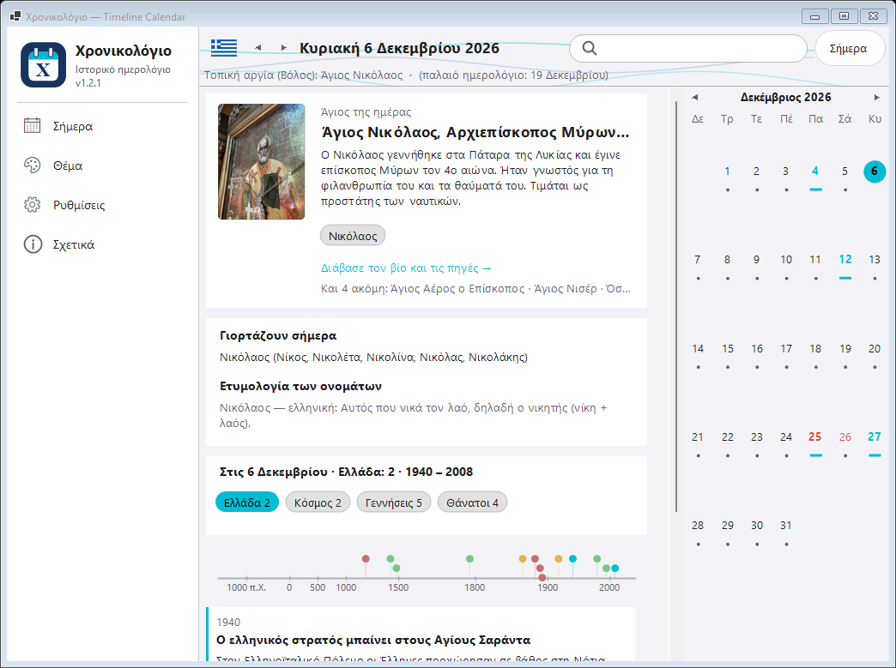</a> window day dark</td>
<td width="50%" valign="top"> window day light</td>
</tr>
</table>

## Calendar panels / Πλαίσια ημερολογίου

<table>
<tr>
<td width="50%" valign="top"><a href="product-snapshots/panel-dark-0325.png">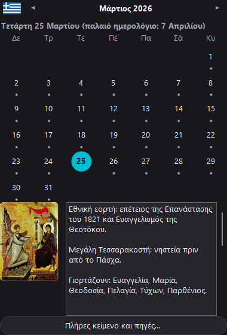</a> panel dark 0325</td>
<td width="50%" valign="top"><a href="product-snapshots/panel-dark-0709.png">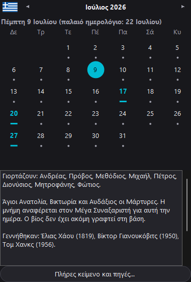</a> panel dark 0709</td>
</tr>
<tr>
<td width="50%" valign="top"><a href="product-snapshots/panel-dark-1206.png">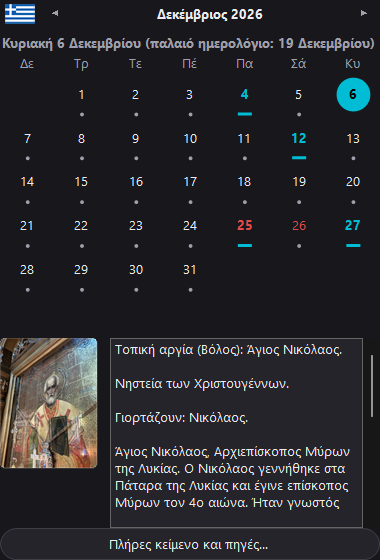</a> panel dark 1206</td>
<td width="50%" valign="top"><a href="product-snapshots/panel-light-0325.png">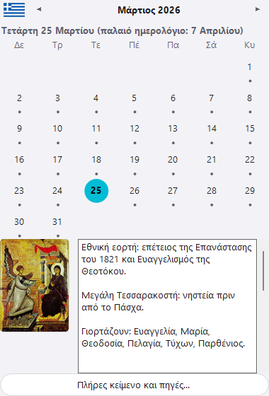</a> panel light 0325</td>
</tr>
<tr>
<td width="50%" valign="top"><a href="product-snapshots/panel-light-0709.png">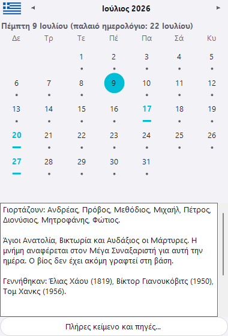</a> panel light 0709</td>
<td width="50%" valign="top"><a href="product-snapshots/panel-light-1206.png">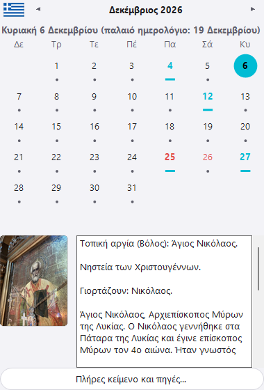</a> panel light 1206</td>
</tr>
</table>

## Historical details / Ιστορικά γεγονότα

<table>
<tr>
<td width="50%" valign="top"><a href="product-snapshots/details-dark-0325.png">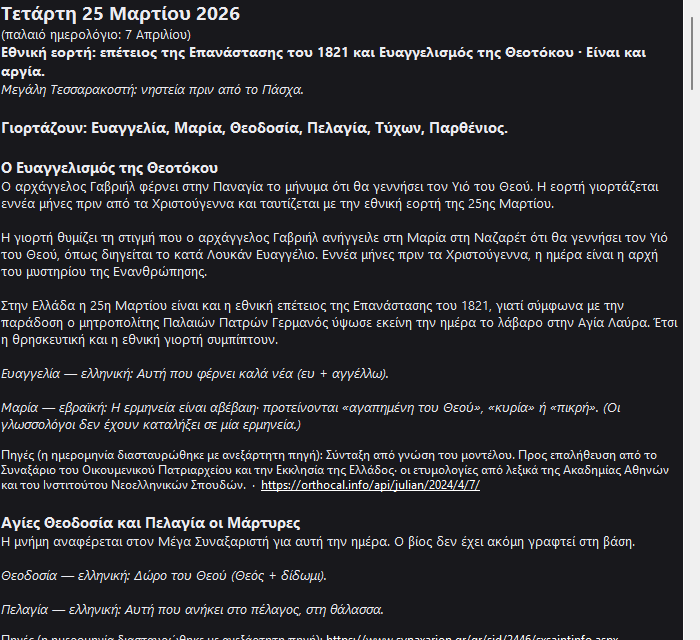</a> details dark 0325</td>
<td width="50%" valign="top"><a href="product-snapshots/details-dark-0709.png">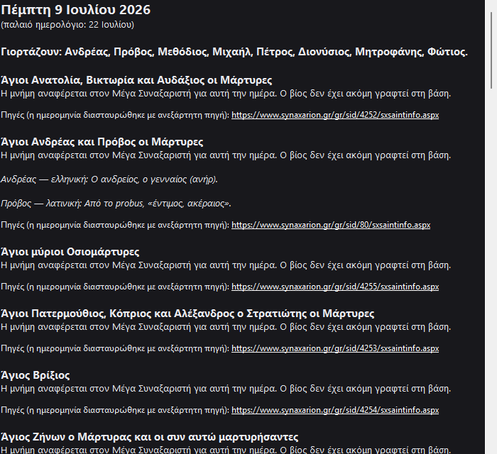</a> details dark 0709</td>
</tr>
<tr>
<td width="50%" valign="top"><a href="product-snapshots/details-dark-1206.png">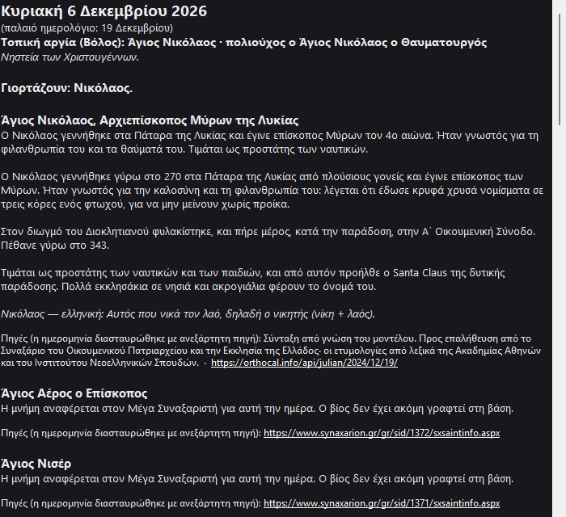</a> details dark 1206</td>
<td width="50%" valign="top"><a href="product-snapshots/details-light-0325.png">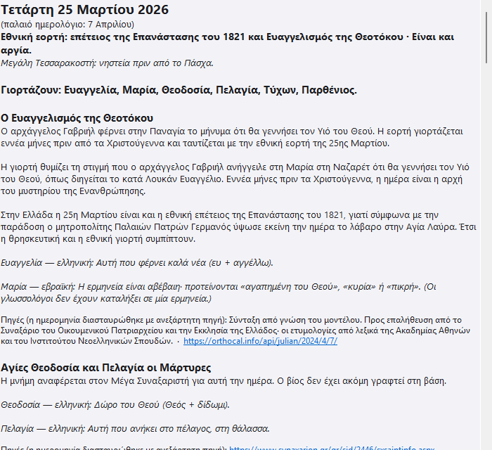</a> details light 0325</td>
</tr>
<tr>
<td width="50%" valign="top"><a href="product-snapshots/details-light-0709.png">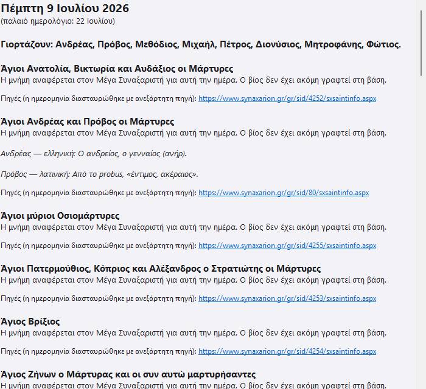</a> details light 0709</td>
<td width="50%" valign="top"><a href="product-snapshots/details-light-1206.png">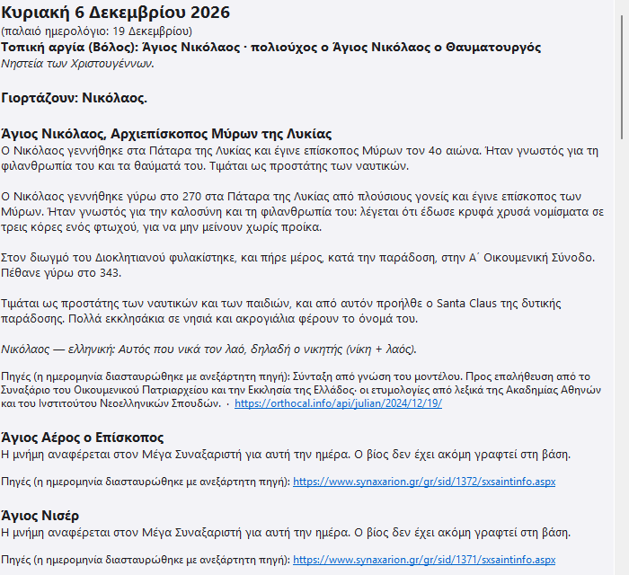</a> details light 1206</td>
</tr>
</table>

---

Refresh the preview selection after the next release is finalized. / Ανανέωση εικόνων μετά την οριστικοποίηση επόμενης έκδοσης.
