# Application screenshots / Στιγμιότυπα εφαρμογής

Source commit: a4d12577d59310c27ff7c9437c6bd2cf3aa0a5f2

Actual WinForms calendar, detail and main-window renderings with representative dates and both themes; not a live desktop capture.

### details-dark-0325.png

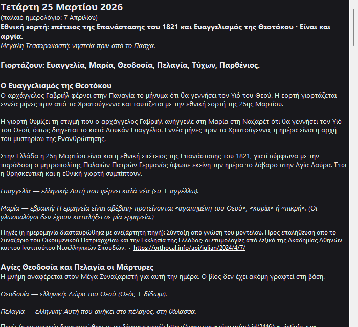

### details-dark-0709.png

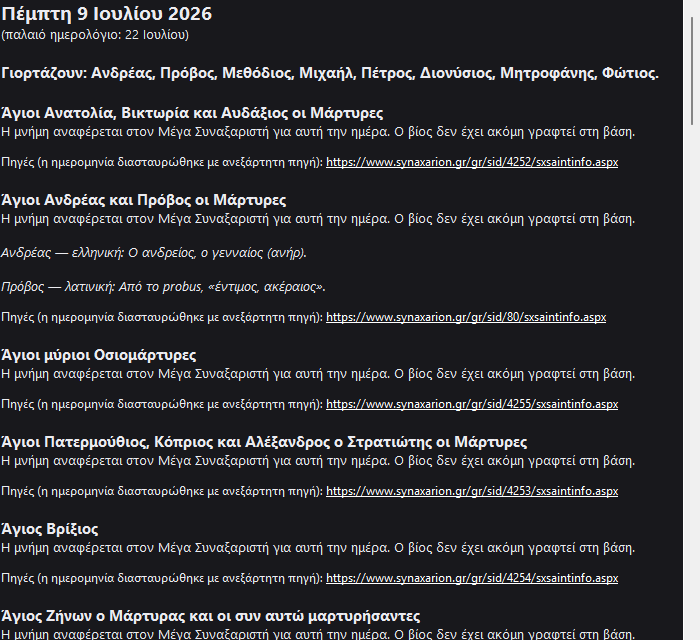

### details-dark-1206.png

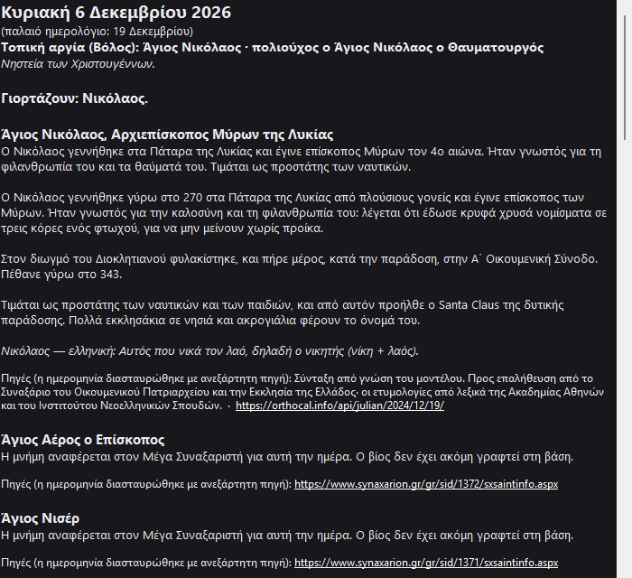

### details-light-0325.png

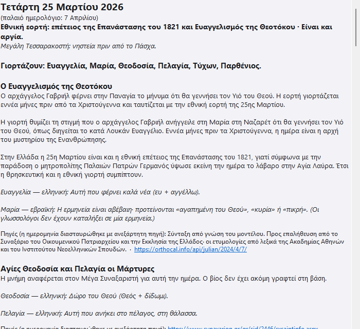

### details-light-0709.png

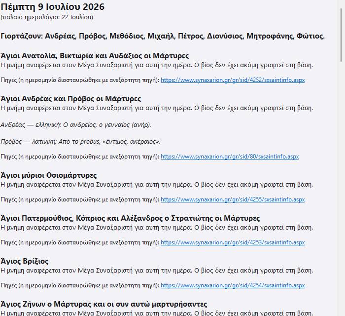

### details-light-1206.png

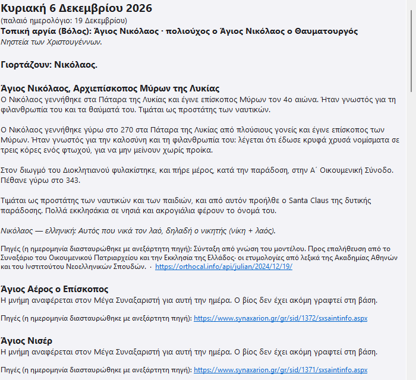

### panel-dark-0325.png

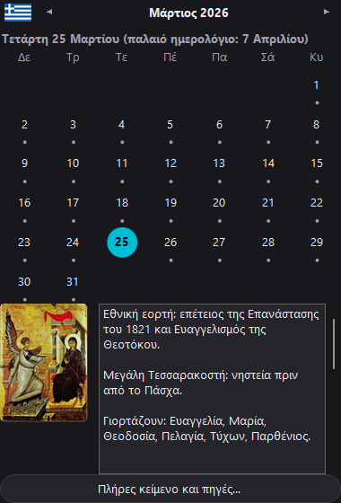

### panel-dark-0709.png

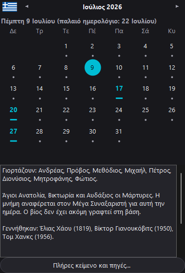

### panel-dark-1206.png

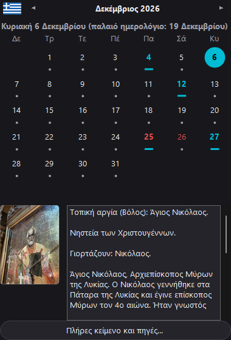

### panel-light-0325.png

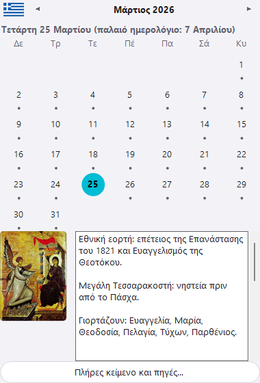

### panel-light-0709.png

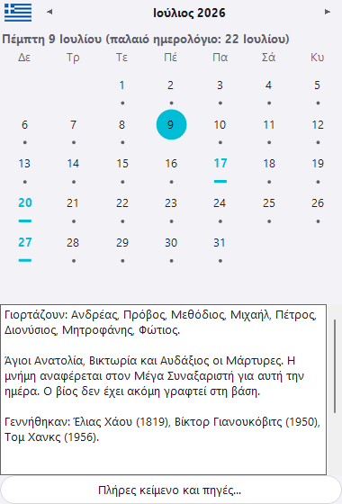

### panel-light-1206.png

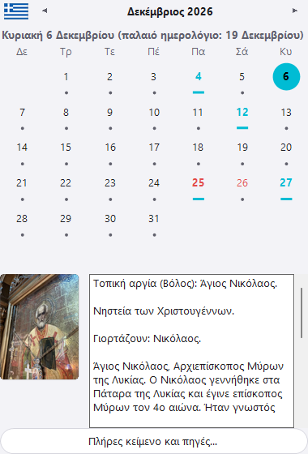

### window-day-dark.png

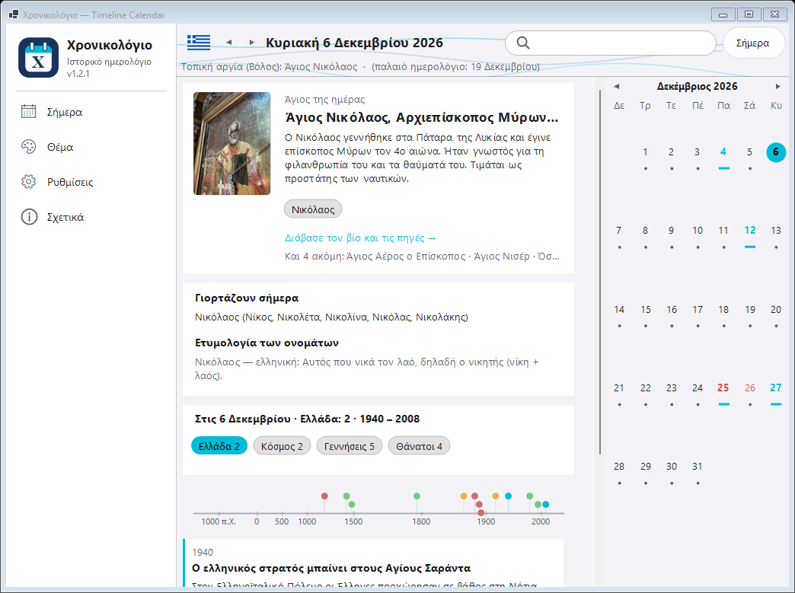

### window-day-light.png

